**English** | [Português (Brasil)](README.pt-BR.md)

<p align="center">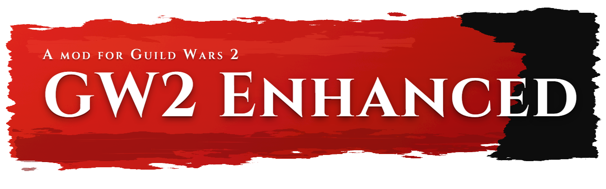</p>

<h1 align="center">GW2 Enhanced</h1>

<p align="center"><a href="https://www.buymeacoffee.com/wilssola"></a></p>

An unofficial, client-side mod for **Guild Wars 2** with three features that can be used together or alone:

| Feature | What it does |
|---|---|
| **Translation** ([`translated/`](translated/README.md)) | Translates the game's text into Brazilian Portuguese, in memory, while you play. What the dictionary lacks is translated on your own PC (CPU or graphics card). |
| **HD Textures** ([`remastered/`](remastered/README.md)) | Serves AI-upscaled versions of the game's textures (2x, and 4x for your character) from a separate HD pack ([download on Nexus Mods](https://www.nexusmods.com/guildwars2/mods/10)). |
| **Graphics** ([`graphics/`](graphics/README.md)) | Real HDR output (scRGB or HDR10), bloom, ambient occlusion, reflections, light shafts, contact shadows, lens effects, colour grading and photo mode, on top of the game's own renderer. |

Everything ships as **one file, `msimg32.dll`**, placed next to `Gw2-64.exe`. The game's files (`Gw2.dat`, `Gw2-64.exe`) are never modified, and removing the DLL restores the original game.

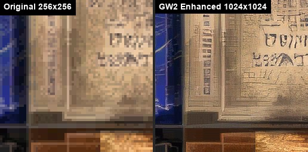
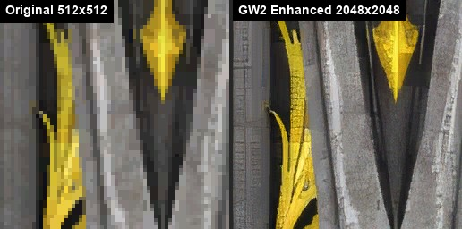
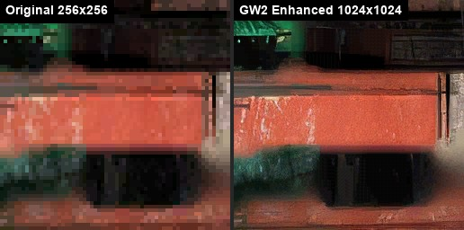
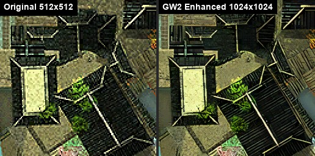
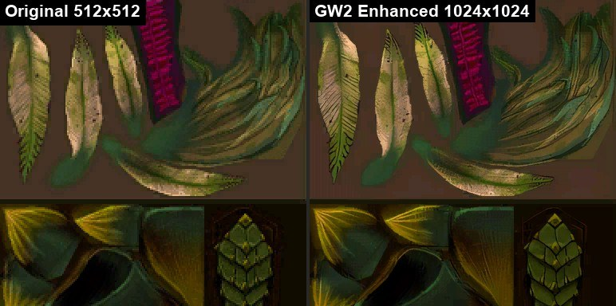
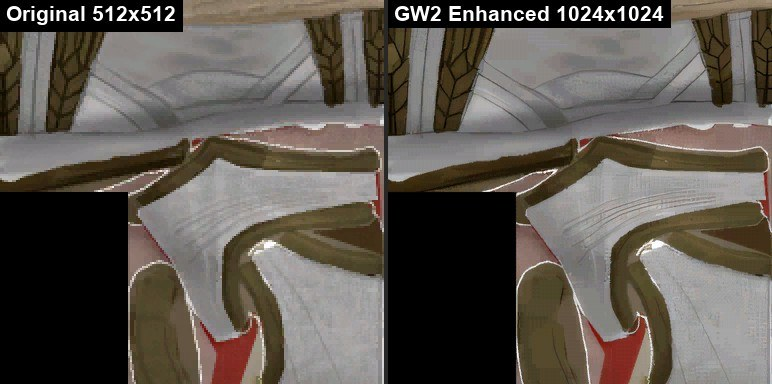
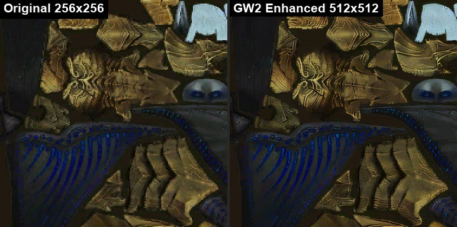
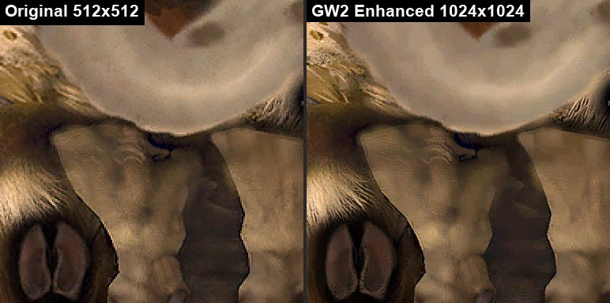
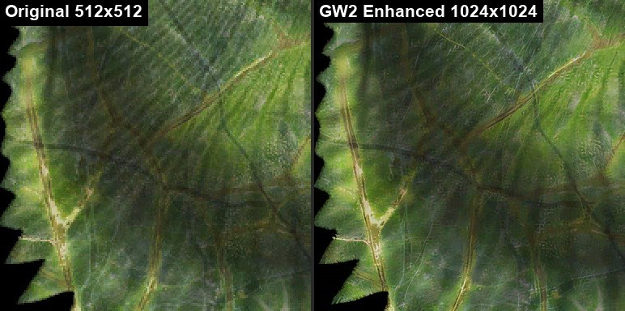
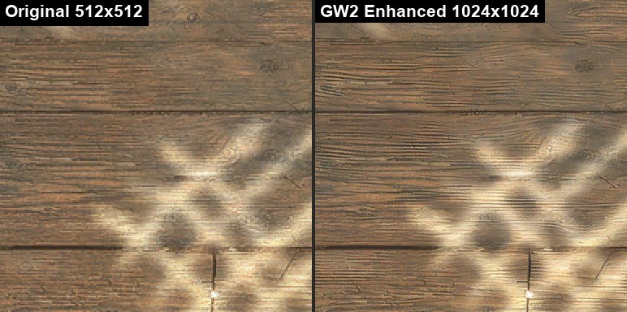
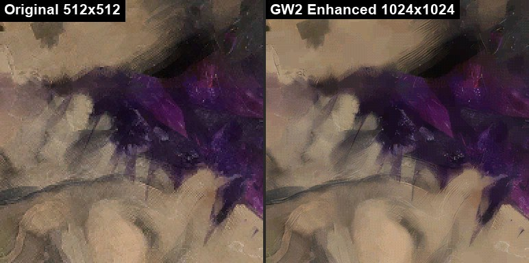
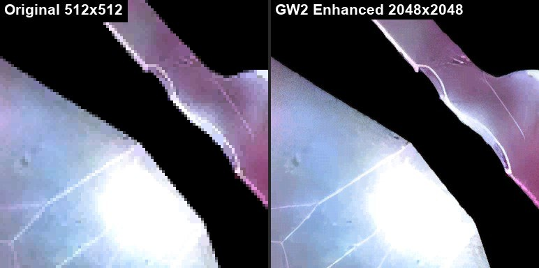
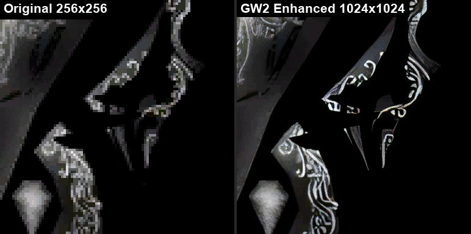
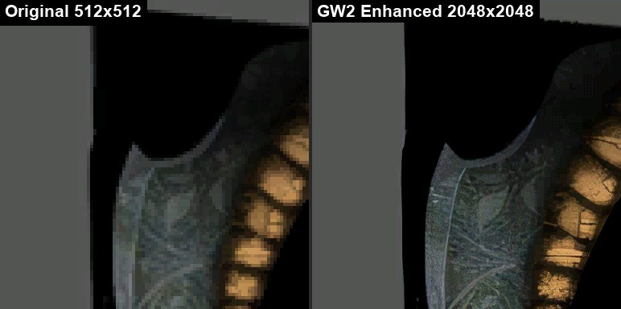

*Left: the game's texture, enlarged. Right: the same texture from the HD pack. Crops of the textures themselves, not in-game screenshots.*

### In the game

Crops of in-game screenshots taken with the mod's own comparison captures (the Screenshots tab of the overlay), the same
moment without and with the feature.

**Translation**

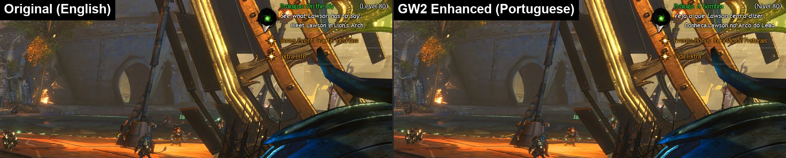
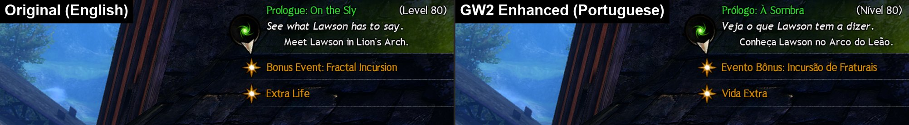
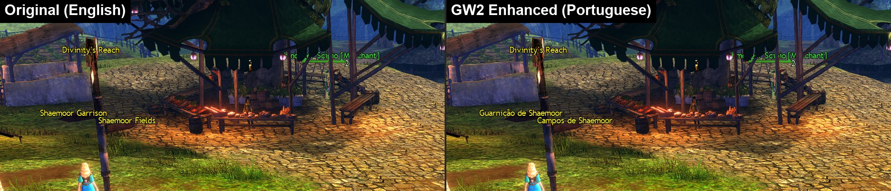
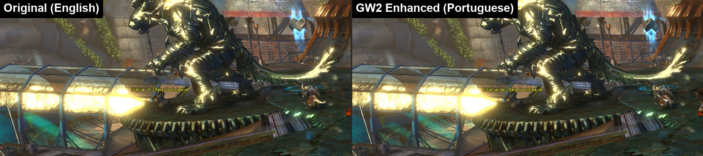
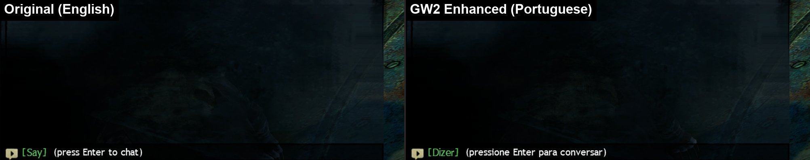
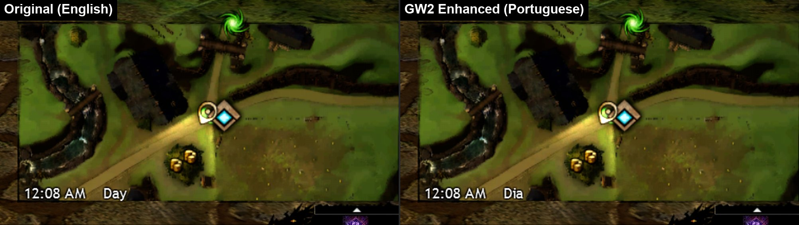

**HD textures**

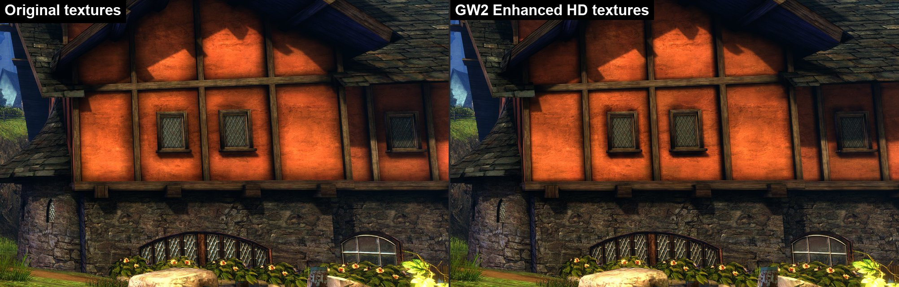
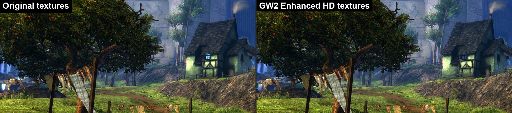
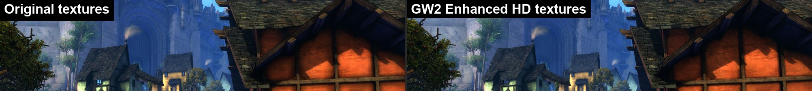
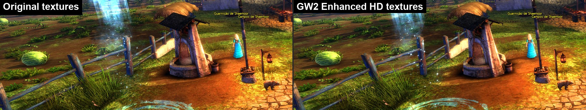
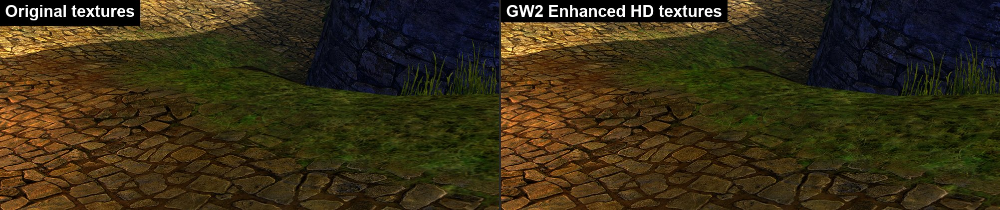
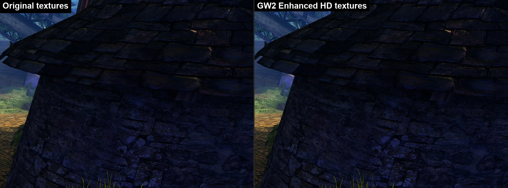
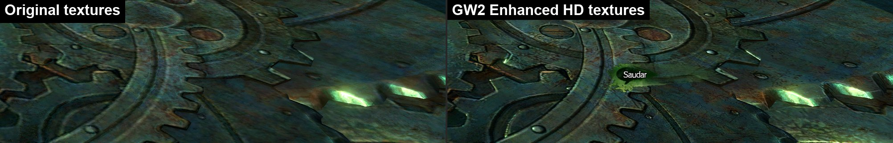
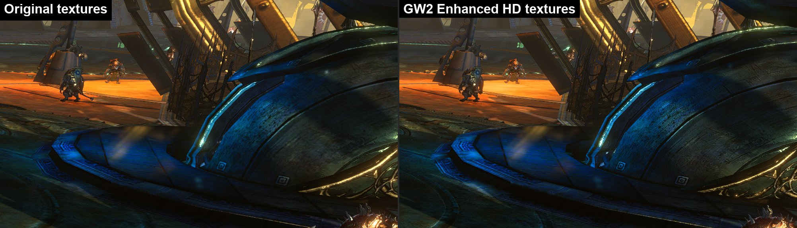

**Graphics** (3D scene without the UI)

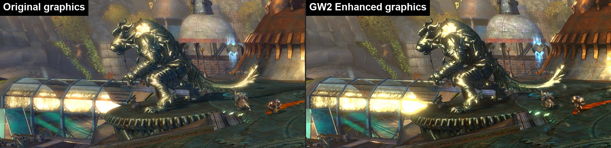
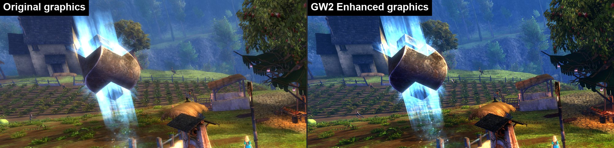
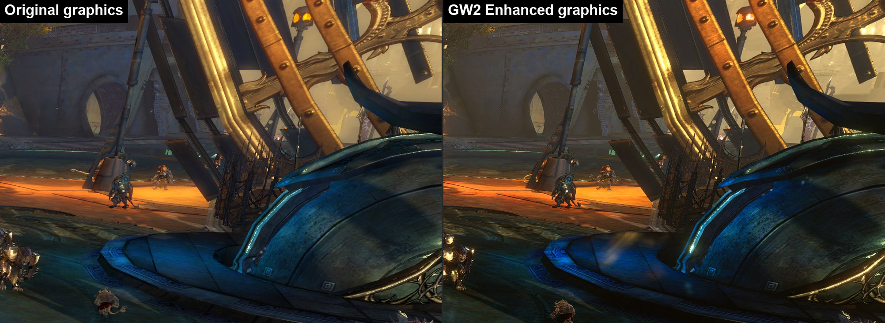
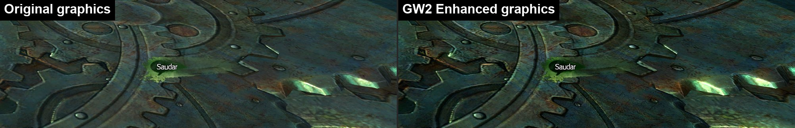
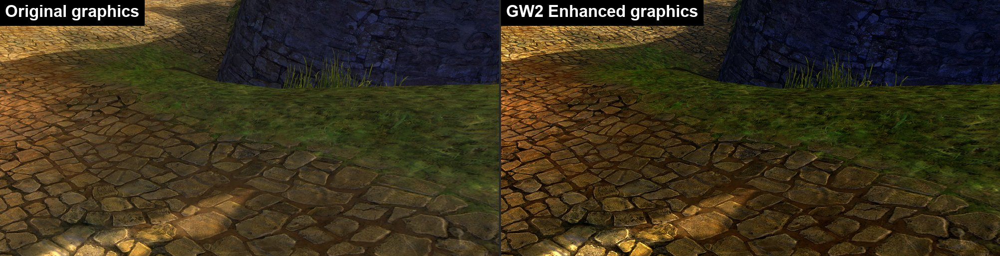
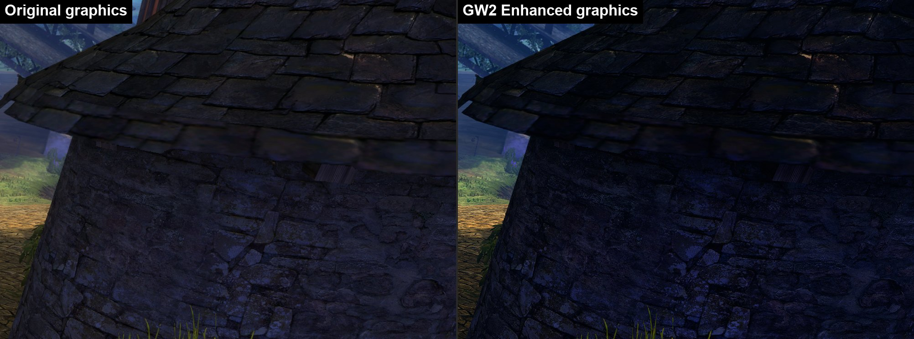

## How the HD textures were made

The HD pack is a **remaster of the game's own textures**, not new art. Nothing was drawn, painted, prompted or
generated from scratch; every HD texture is the original texture, enlarged.

**The game's art style is kept.** Guild Wars 2's painterly look, its colours and its hand-painted details are
ArenaNet's, and the pack does not change them: no recolouring, no "realistic" restyle, no new materials, no filters.
The goal is that the game looks exactly like itself, only sharper up close.

1. **Extract.** Every texture is decoded from the player's `Gw2.dat` (about 432 thousand textures; about 231 thousand of them end up in the pack), with the exact pixels and
   GPU format the game uses.
2. **Classify.** Each texture is identified by what uses it (character atlas, hair and eyes, weapons and armor,
   scenery, creatures, effects, terrain, UI) and gets a target size from that, not from its size alone. UI, cinematic
   art, tiny textures and textures that are already large enough are left as they are.
3. **Upscale.** Colour textures go through **[4x-UltraSharp](https://huggingface.co/Kim2091/UltraSharp)**, a
   single-image super-resolution model, run locally on the GPU in tiles. Normal maps, masks and other data textures are
   **not** sent through any model: they are resized with Lanczos, since a model could invent values in them.
4. **Encode.** Each result goes back into the **same block format** the game shipped (BC1/BC3/BC5/BC7...), so the engine
   reads it as if it were its own texture, and pairs of textures that the engine expects at an exact 2x ratio keep it.
5. **Pack.** The results are stored in a few large archives with an index, which the mod reads at run time when the
   game asks for a texture (see [`remastered/`](remastered/README.md) for the details and the tools).

**Is this generative AI?** No, not in the usual sense. 4x-UltraSharp is an ESRGAN-architecture super-resolution network
(a convolutional image-to-image upscaler): its only input is the original texture, it has no prompt and no text model,
and it does not create content that is not already there. Run twice on the same texture, it gives the same result. It
does **sharpen and reconstruct fine detail** (edges, grain, small patterns) that a plain resize would blur, which is
what it was trained for, on pairs of low and high resolution photos. The shapes, colours, layout and design of every
texture stay ArenaNet's.

4x-UltraSharp is by Kim2091, under [CC BY-NC-SA 4.0](https://creativecommons.org/licenses/by-nc-sa/4.0/): the HD pack
is free and non-commercial.

## Downloads

Every release on the [Releases page](https://github.com/wilssola/GW2Enhanced/releases) carries:

| File | Contents |
|---|---|
| `GW2Enhanced-All-<version>.zip` | all three features, translation with every translator mode |
| `GW2Enhanced-Translation-<version>.zip` | only the translation, every translator mode |
| `GW2Enhanced-Translation-CPU-<version>.zip` | only the translation, translator on the processor (smallest) |
| `GW2Enhanced-Translation-CUDA-<version>.zip` | only the translation, translator on NVIDIA cards (CUDA) |
| `GW2Enhanced-Translation-DirectML-<version>.zip` | only the translation, translator on any DirectX 12 card (AMD, Intel, NVIDIA) |
| `GW2Enhanced-Textures-<version>.zip` | only the HD textures runtime (the pack itself is a separate download, see below) |
| `GW2Enhanced-Graphics-<version>.zip` | only the graphics |
| `SHA256SUMS.txt` | the SHA-256 of every file above |

Each release also has a build provenance attestation: GitHub signs which commit and which workflow run produced every
file, so anyone can check a download with `gh attestation verify <file> --repo wilssola/GW2Enhanced`.

The **HD texture pack** (about 95 GB) is published on [Nexus Mods](https://www.nexusmods.com/guildwars2/mods/10), split into a required main pack and two optional 4x
packs. Extract every part into the game folder; the mod looks for `GW2Remastered\pack` there (or the folder you pick
in its panel).

## Installing

1. Close the game.
2. Extract the zip into the game folder (the one with `Gw2-64.exe`), or run the installer it contains, which finds the
   folder by itself. If another mod already has a `msimg32.dll` there, the installer warns and only replaces it if you
   choose to (it is then kept and put back on uninstall). The `version.dll` of the earlier
   separate GW2 Translated is removed (the translation now lives in `msimg32.dll`).
3. Start the game. **Shift+Home** opens the overlay, with one tab per feature and a **Health** tab that lists every part of the
   mod and whether it is working. Hotkeys are in the **Version** tab (and `GW2Enhanced\config.ini`): one for the window and one per feature, all
   **Shift+Home** by default; a feature's own key opens the window straight on its tab.

The installer (`GW2Enhanced-Installer.exe`) is also a small launcher: it finds the game on Steam, Epic Games and the
ArenaNet client, lists the releases with their notes, downloads and installs a package with the same signature
check as the in-game updater, and starts the game through the right store.

| | |
|---|---|
| 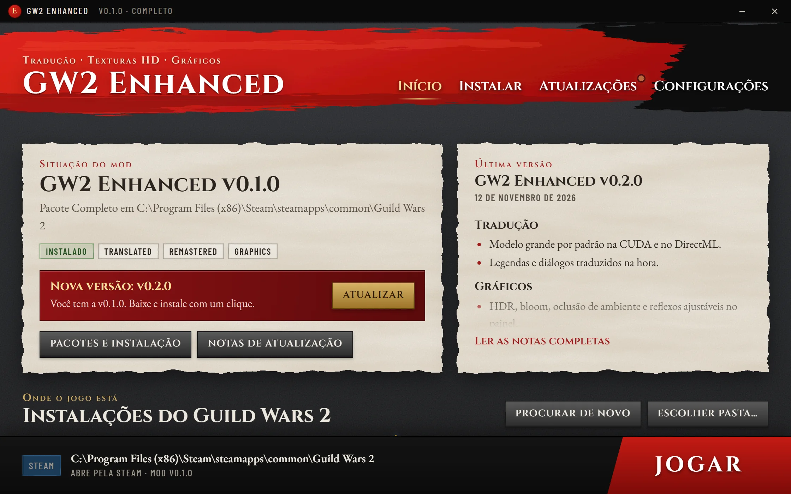 | 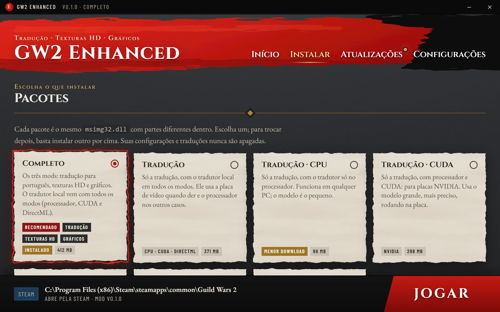 |
| 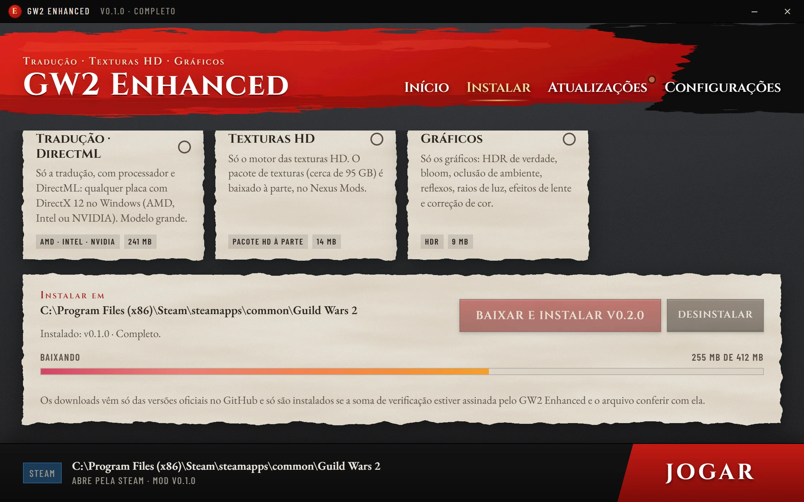 | 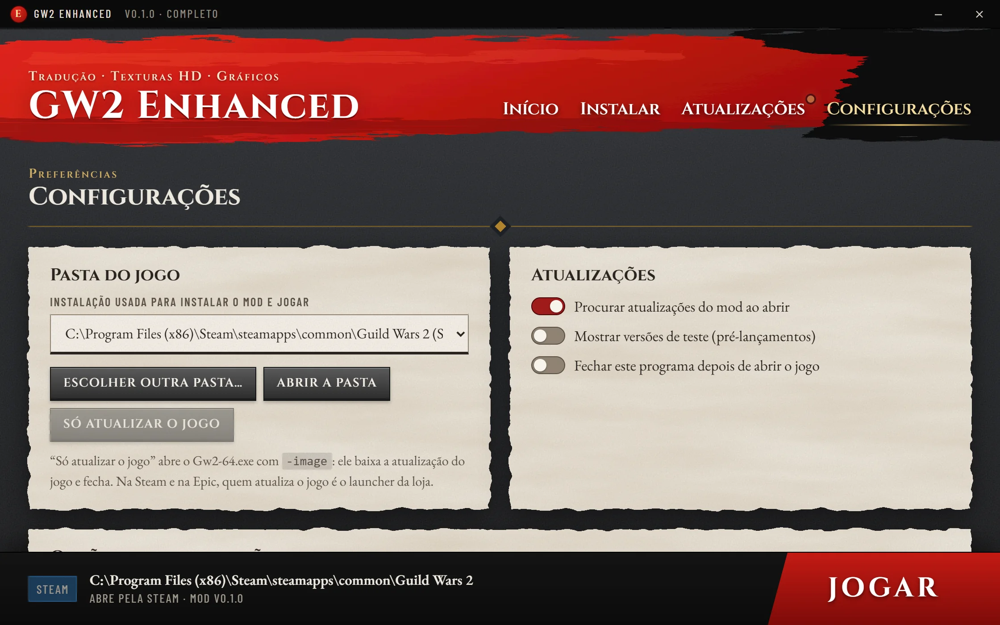 |

<sub>The installer (in Portuguese), shown with sample data.</sub>

On Linux, use `GW2Enhanced-Installer-linux-amd64.AppImage` (or the `.deb`) from the release. Wine and
Proton load their own `msimg32.dll` unless told otherwise, so the game needs the launch option
`WINEDLLOVERRIDES="msimg32=n,b" %command%` in Steam; the installer can add it for you (with Steam closed). See
[installer/docs/launch-methods.md](installer/docs/launch-methods.md).

To uninstall, delete `msimg32.dll` from the game folder (or run the installer with `--uninstall`). An old
`wtsapi32.dll` from the earlier standalone graphics build is not removed by the installer: delete it by hand.

## Settings and logs

`GW2Enhanced\config.ini` in the game folder holds the settings shared by the whole mod; the overlay writes it for you:

| Key | Default | Meaning |
|---|---|---|
| `ui_language` | Windows language | Language of the overlay: `en` or `pt-BR` (the selector above the tabs). Portuguese Windows starts in `pt-BR`, anything else in English. This is not the language the game is translated into: that is the Translation tab's "Game translation language". |
| `log_host` | `0` | Log of the overlay and the updater: `GW2Enhanced\gw2enhanced_log.txt` |
| `log_translation` | `0` | Log of the translation: `GW2Translated\gw2translated_log.txt` |
| `log_textures` | `0` | Log of the HD textures: `GW2Remastered\gw2remastered_log.txt` |
| `log_graphics` | `0` | Log of the graphics: `GW2Graphics\gw2graphics_log.txt` |
| `graphics_setup_done` | `false` | The graphics part of the first-time setup was finished or skipped (`false` shows it again) |
| `check_updates` | `true` | Look for a new release at start |

Logs are **off by default**: no log file is written. When you report a problem, turn on **Logs** for the part that
misbehaves in the overlay's Health tab first (it applies right away), reproduce the problem, then attach that file (and
its `.prev.txt`, the session before). With the logs off, the Health tab still shows each part's state and the recent
problems it noticed.

## Updates

At each start the mod checks the latest release. When there is a newer one, it asks in the overlay; if you accept, it
downloads the same package you installed (same features, same translator mode), checks it against the release's
`SHA256SUMS.txt` and that file's ed25519 signature, replaces its files, and closes the game so the next start runs the new version. Nothing is replaced
if a download is incomplete, does not match its checksum or the checksums are not signed by the project's key.

Your settings (`config.ini`) and your own translations are never touched. To turn the check off, put
`check_updates=false` in `GW2Enhanced\config.ini` in the game folder. The Health tab shows the update state, and
`GW2Enhanced\gw2enhanced_log.txt` what the updater did (with `log_host=1`, see [Settings and logs](#settings-and-logs)).

## How it works

- **One proxy DLL.** `Gw2-64.exe` imports `msimg32.dll`, a small Windows library (5 functions) that is not on the
  KnownDLLs list, so Windows loads the copy in the game folder first. Ours forwards those 5 functions to the real one in
  System32 and starts the features on their own threads, never under the loader lock.
- **Isolation.** Each feature starts inside its own guard: if one fails (for example after a game patch), it turns itself off,
  says why in the Health tab and the log, and the others keep running.
- **Translation** hooks the functions where the game turns a string id into text, and swaps in the translated text
  from a dictionary (by id, so it works with any client language). Missing strings are queued for a local translator
  (CTranslate2 with an OPUS-MT model) that runs as a separate process.
- **HD textures** hooks the game's file layer at the point where it reads a texture from `Gw2.dat`, and returns the HD
  version from the pack instead (stored as the same GPU block format the game expects, so nothing is converted at run
  time). The pack is a handful of large archive files with an index, read by offset.
- **Graphics** hooks Direct3D 11 and recognises the game's render passes by their structure (formats, sizes, order,
  draw counts), and the few engine shaders it replaces by the hash of their bytecode. It upgrades the scene's render
  targets to floating point, adds its effects between the game's passes, and converts the result to HDR at the end.
- Game code is found by byte signatures with wildcards over relocations, which survived the patches so far unchanged;
  see [the architecture of the mod](docs/specs/unified-mod-design.md) for how the mod locates game code, degrades
  when a patch breaks something, and updates itself.

## The translation

- **A dictionary ships with the mod** (`GW2Translated\languages\pt-BR\dictionary.jsonl`, about 205 thousand strings).
  Texts are looked up by their English text and by the game's text ID, so the translation also works with the game in
  another language; a translation can be any length.
- **What the dictionary lacks is translated on your PC**, offline: a local translator (CTranslate2 with an OPUS-MT
  model) runs as a separate process at low priority, on the processor (small model) or on the graphics card (a larger
  model, on NVIDIA through CUDA or on any DirectX 12 card through DirectML). It needs the English client. Map dialogue
  is translated ahead of time, and the result is shown as soon as it is ready. The Trading Post, Gem Store and Wizard's
  Vault pages are translated the same way.
- **The community website** ([gw2enhanced.wilssola.dev](https://gw2enhanced.wilssola.dev)) shows every text with
  its translation and alternatives. Anyone can vote a translation up or down or suggest a better one, without an
  account (a Cloudflare Turnstile check, one vote per IP per translation). The best-voted reviewed translation becomes
  the current one.
- **Sending texts is optional.** On first use the overlay asks whether you want to help (`contribute=ask` until you
  answer). If you agree, the mod sends the English game texts it found that have no translation yet, the text ID and
  English of protected strings it decrypted, and the translations made on your PC. It never reads, saves or sends
  player chat, and never sends personal data or the web page texts translated on your PC (`web_local.jsonl`). It can
  be turned off at any time in the overlay ("Help improve the translation") or with `contribute=false` in
  `GW2Translated\config.ini`.
- **The server trusts nothing it receives** ([API](backend/docs/api.md)). Everything goes to a review queue first:
  English texts are checked against what other players sent for the same ID or reviewed as plausible game text, and
  translations are reviewed automatically (they must translate the English, keep the game's markup, and not be a
  joke, an insult, spam or a link). A text keeps at most 10 different translations, and a translation sent for a text
  that already has a translation made by the server's own model is not stored. IP addresses are never stored: only
  salted HMAC-SHA256 hashes of the address and of its network range, for rate limits and bans.

## The graphics, compared with other graphics mods

The Graphics feature works **inside the game's own renderer**. It hooks the Direct3D 11 calls of the engine, recognises
its passes, and works between them: it sees the scene and the engine's own depth buffer **before the UI is drawn**,
so its effects never touch the interface and use real scene depth. It makes **real HDR** possible by creating the
scene's render targets as 16-bit floating point instead of 8 bits, so fire, spells and the sun can be brighter than
white all the way to an HDR monitor. It needs **no neural network** and no vendor-specific API: plain Direct3D 11
shaders, on any graphics card the game runs on. Every effect has its own switch, and it is designed to run next to
ReShade.

| | GW2 Enhanced Graphics | [ReShade](https://reshade.me) (presets such as [Elora's](https://alteredm1nd.github.io/gw2-reshade-eloras-personal-presets)) | [RenoDX](https://github.com/clshortfuse/renodx) | [GW2Hook](https://04348.github.io/Gw2Hook) | [d912pxy](https://github.com/megai2/d912pxy) | [NVIDIA DLSS 5](https://www.nvidia.com/en-us/geforce/news/dlss-5-3d-guided-neural-rendering/) |
|---|---|---|---|---|---|---|
| What it is | Effects and HDR inside the game's render passes | Post-processing shaders on the game's frame | ReShade add-on that replaces a game's shaders, mainly for HDR | ReShade fork made for GW2 | DirectX 9 to DirectX 12 wrapper | AI rendering stage at the end of a game's pipeline |
| Where it works | Between the engine's passes, before the UI | On the presented frame (the UI included, unless an add-on finds an earlier point) | Per-game shader replacement | Fog shader patching, effects before the HUD | Translates the whole DX9 API | Inside games that integrate it |
| HDR | Float scene targets, scRGB or HDR10 output | Depends on the game and the add-ons | Its main purpose | No | No | Not its purpose |
| GPU | Any card that runs the game | Any | Any | Any | Any (DX12) | GeForce RTX 50 series |
| Status for GW2 | Current | Works with the DX11 client (as `d3d11.dll`/`dxgi.dll`) | GW2 mod listed as in progress | Made for the old DirectX 9 client | Obsolete: GW2 dropped DirectX 9 | GW2 does not integrate it |

Notes on the table:
- ReShade is the usual way to restyle GW2: colour presets, sharpening, ambient occlusion and depth of field from
  depth. Its effects run on the image the game presents; the Graphics feature changes how the frame is rendered. Both
  can be used together: with ReShade loaded, `hdr_output=auto` stays SDR because ReShade's effects on the swapchain
  are not HDR-safe ([details](graphics/README.md#hdr-output-and-reshade)).
- RenoDX's mod list has a Guild Wars 2 entry marked "in progress, lacking testing"
  ([RenoDX mod list](https://github.com/clshortfuse/renodx/wiki/mods)).
- GW2Hook targeted the DirectX 9 client (fog removal by patching pixel shaders, effects applied before the names and
  HUD). d912pxy was archived in May 2025, after the DirectX 11 client: ArenaNet moved every player to DirectX 11 and removed the
  DirectX 9 renderer ([ArenaNet, system requirements](https://guildwars2.com/en/news/guild-wars-2-minimum-system-requirements-update)).
- DLSS 5 (announced March 2026) is an AI model that adds lighting and material detail at the end of the pipeline,
  from a frame's colour and motion vectors plus engine data; game developers must build it in, and it needs a
  GeForce RTX 50 series card. GW2 has no native DLSS or FSR upscaling. GW2 Enhanced does not upscale and does not use
  AI at run time.
- Performance: the extra passes are small (most effects are estimated well under a millisecond at 3440x1440 on a
  mid-range GPU; in-game profiling is still to be done), and an effect switched off (strength 0) adds no passes at all.
  Per-effect numbers are in [graphics/docs](graphics/docs/specs/graphics-design.md).

## Building

One Cargo workspace; Windows, Rust stable, MSVC.

```sh
cargo build --release              # target/release/msimg32.dll with the three features (+ the installer)
cargo mod-translation              # msimg32.dll with only the translation
cargo mod-textures                 # ... only the HD textures
cargo mod-graphics                 # ... only the graphics
cargo test --workspace             # the graphics tests take about 30 min (shaders on WARP)
```

Every project builds the same `msimg32.dll`; the cargo features of [`enhanced/`](enhanced) (`translation`, `textures`,
`graphics`) choose what goes in. The local translator (`-p gw2translated-translator`) needs the CTranslate2 and
DirectML runtimes, fetched by the scripts in `translated/scripts`. The translation model is stored with Git LFS.

`.\scripts\package.ps1 [-Version 1.2.0] [-Package Graphics,...]` builds the release zips of the table above in
`dist\`. It needs neither Git LFS nor anything installed by hand except Rust, Visual Studio with C++ and, for the
CUDA and DirectML packages, [uv](https://docs.astral.sh/uv/): the runtimes, cuBLAS and the small model are
downloaded (pinned, SHA-256 checked) and the big model is converted from Hugging Face. CI
([`ci.yml`](.github/workflows/ci.yml)) builds and tests every push and pull request; pushing a tag `v<version>`
(or running [`release.yml`](.github/workflows/release.yml) by hand) publishes a release.

| Folder | What |
|---|---|
| `enhanced/` | the DLL: entry point, proxy, the shared overlay and Health tab |
| `core/` | shared plumbing: signature search across builds, the health registry |
| `translated/`, `remastered/`, `graphics/` | the three features (libraries compiled into `msimg32.dll`), their tools and docs |
| `installer/` | the installer and launcher (Tauri; Windows and Linux) |
| `backend/` | Cloudflare Worker for translation contributions and releases (separate project) |

## Contributing

Help is welcome, and the **Graphics feature especially needs testers**: players who can try it on different GPUs,
monitors (SDR and HDR) and maps, compare effects on and off, and report what looks wrong or which settings look best.
See [CONTRIBUTING.md](CONTRIBUTING.md) and open a *Graphics calibration report* issue.

- [Contributing guide](CONTRIBUTING.md) · [Code of Conduct](CODE_OF_CONDUCT.md) · [Getting help](SUPPORT.md) ·
  [Security policy](SECURITY.md)
- Translations are improved by voting and suggesting on the [website](https://gw2enhanced.wilssola.dev).

## Credits

- Shell fur (Graphics): the look and the shell technique follow [UnityFurURP](https://github.com/hecomi/UnityFurURP)
  by hecomi; the shaders here are a rewrite for the game's Direct3D 11 renderer.

## Disclaimer

GW2 Enhanced is an **unofficial fan project**. It is not made, endorsed, supported or affiliated with ArenaNet, LLC or
NCSOFT Corporation. It is a client-side mod: it changes only what your own computer shows, sends nothing to the game's
servers and gives no gameplay advantage. Third-party programs that hook the game client are used **at your own risk**;
read ArenaNet's [policy on third-party programs](https://help.guildwars2.com/hc/en-us/articles/360013658134) and the
game's User Agreement before using it. The authors are not responsible for any action taken on your account.

The HD textures are derived from the game's own textures and are distributed only as a mod for owners of the game.
No game files are included in this repository.

## Copyright

© ArenaNet, LLC. All rights reserved. NCSOFT, the interlocking NC logo, ArenaNet, Guild Wars, Guild Wars 2, Heart of
Thorns, Guild Wars 2: Path of Fire, Guild Wars 2: End of Dragons, Guild Wars 2: Secrets of the Obscure, Guild Wars 2:
Janthir Wilds, Guild Wars 2: Visions of Eternity and all associated logos, designs and composite marks are trademarks
or registered trademarks of NCSOFT Corporation. All other trademarks are the property of their respective owners.

The code of GW2 Enhanced is under the [MIT license](LICENSE), except for third-party components, which keep their own
licenses (listed in each mod's README).
