[English](README.md) | **Português (Brasil)**

<p align="center">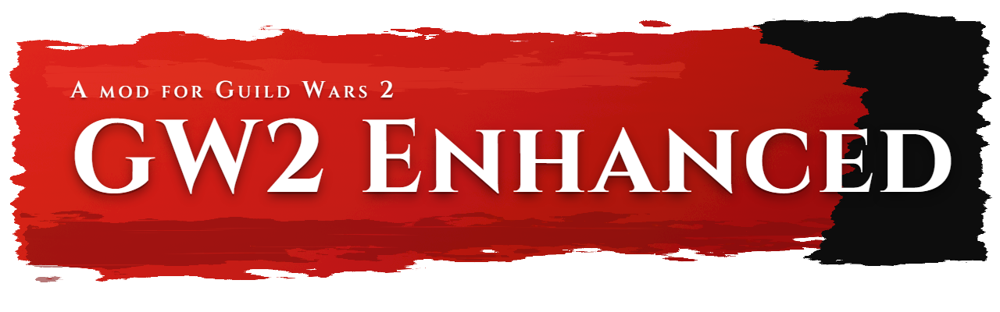</p>

<h1 align="center">GW2 Enhanced</h1>

<p align="center"><a href="https://www.buymeacoffee.com/wilssola"></a></p>

Um mod não oficial, do lado do cliente, para **Guild Wars 2**, com três recursos que podem ser usados juntos ou separadamente:

| Recurso | O que faz |
|---|---|
| **Translation** ([`translated/`](translated/README.md)) | Traduz os textos do jogo para português do Brasil, em memória, enquanto você joga. O que falta no dicionário é traduzido no seu próprio PC (processador ou placa de vídeo). |
| **HD Textures** ([`remastered/`](remastered/README.md)) | Entrega versões das texturas do jogo ampliadas por IA (2x, e 4x para o seu personagem) a partir de um pacote HD separado ([download no Nexus Mods](https://www.nexusmods.com/guildwars2/mods/10)). |
| **Graphics** ([`graphics/`](graphics/README.md)) | Saída HDR de verdade (scRGB ou HDR10), bloom, oclusão de ambiente, reflexos, raios de luz, sombras de contato, efeitos de lente, correção de cor e modo foto, por cima do próprio renderizador do jogo. |

Tudo vem em **um único arquivo, `msimg32.dll`**, colocado ao lado do `Gw2-64.exe`. Os arquivos do jogo (`Gw2.dat`, `Gw2-64.exe`) nunca são modificados, e remover a DLL restaura o jogo original.

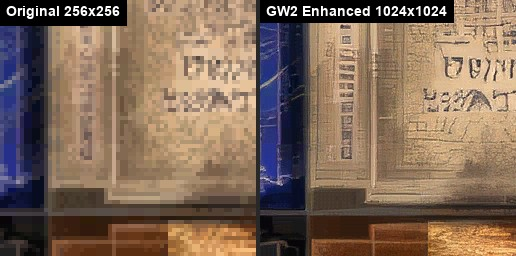
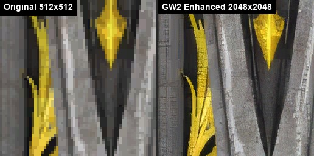
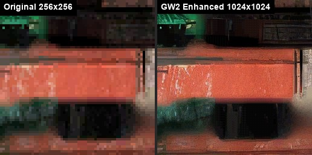
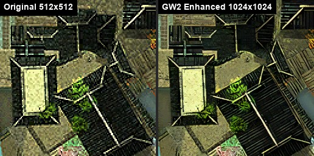
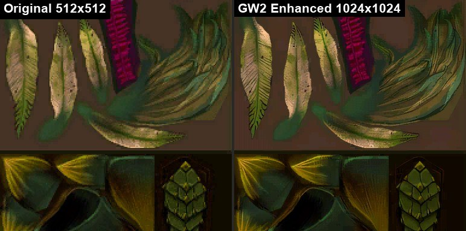
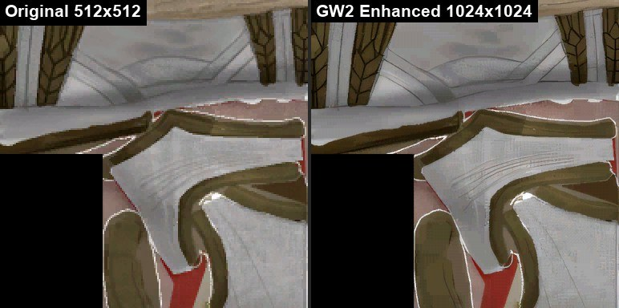
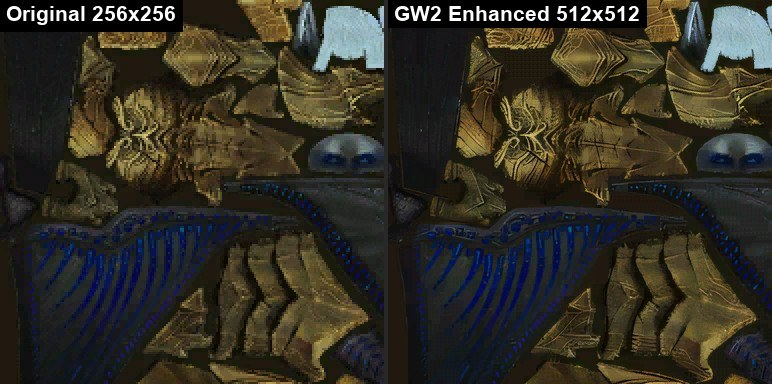
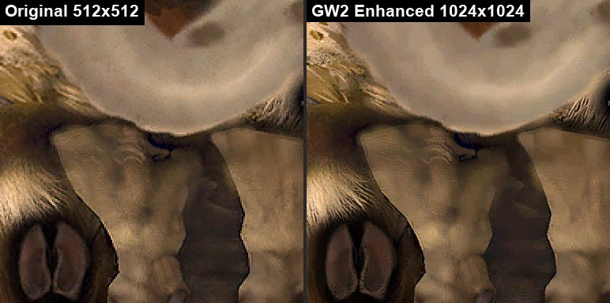
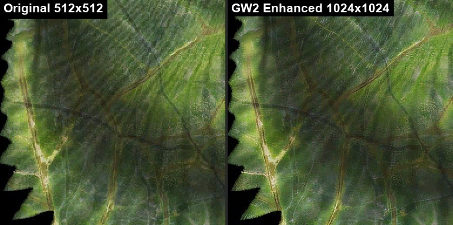
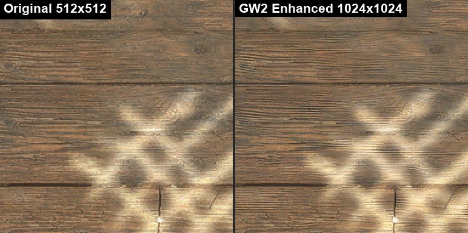
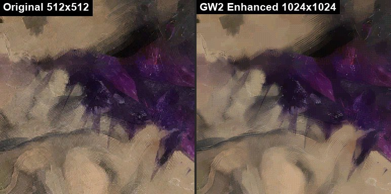
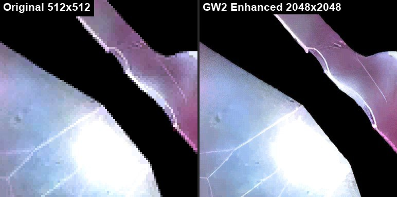
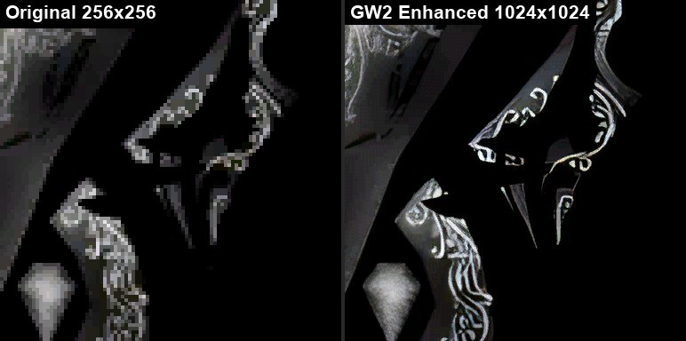
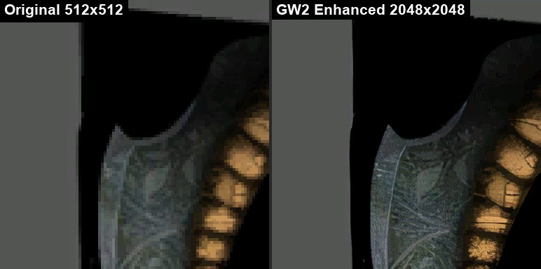

*Esquerda: a textura do jogo, ampliada. Direita: a mesma textura do pacote HD. Recortes das próprias texturas, não capturas de tela do jogo.*

### No jogo

Recortes de capturas do jogo feitas com as comparações do próprio mod (a aba Capturas do overlay): o mesmo momento sem
e com o recurso.

**Tradução**

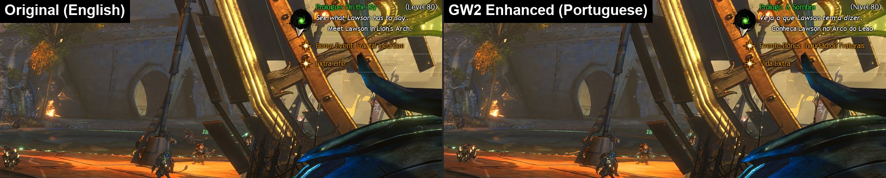
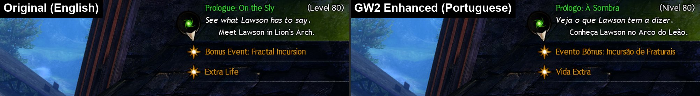
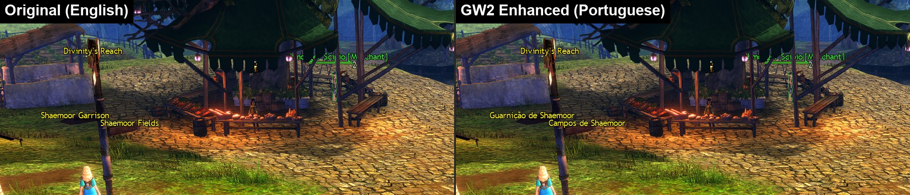
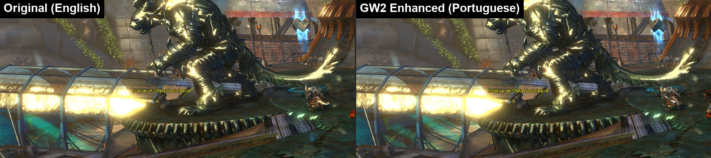
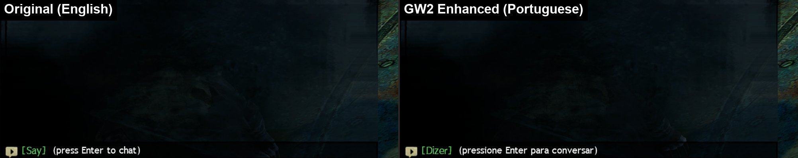
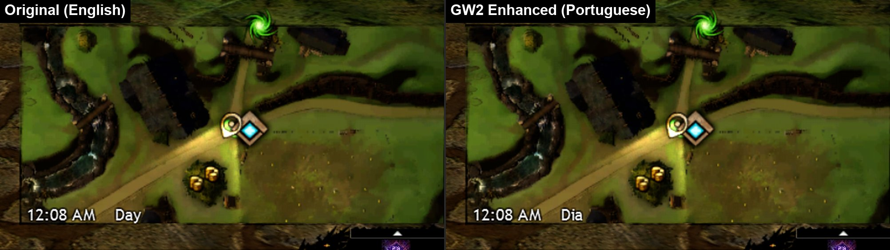

**Texturas HD**

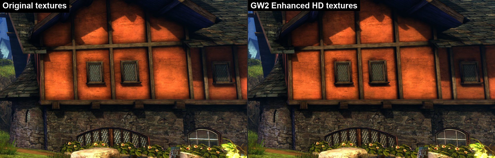
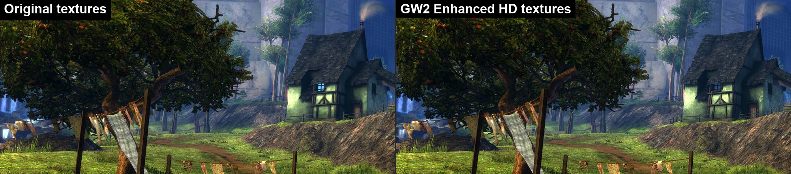
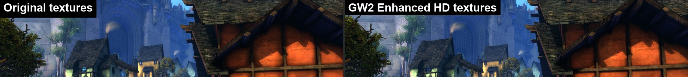
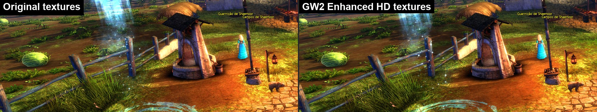
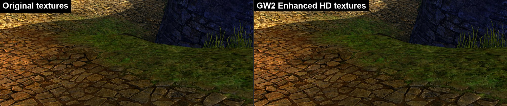
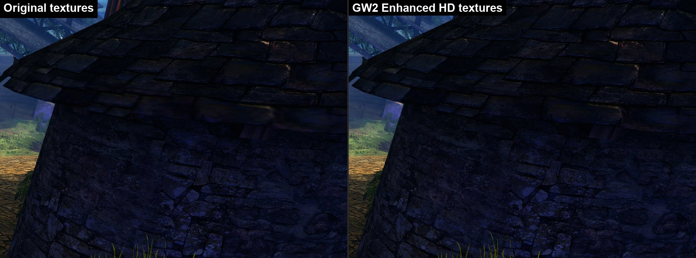
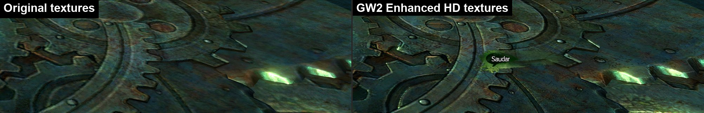
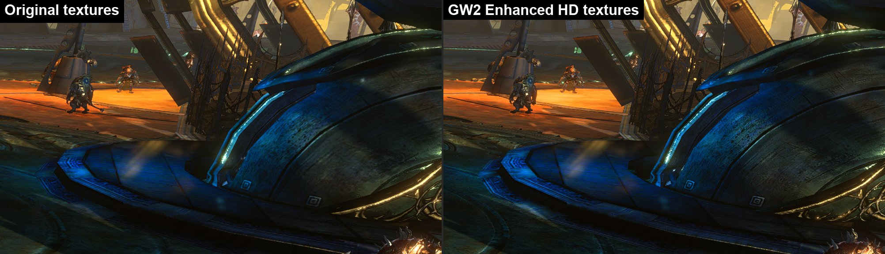

**Gráficos** (cena 3D sem a interface)

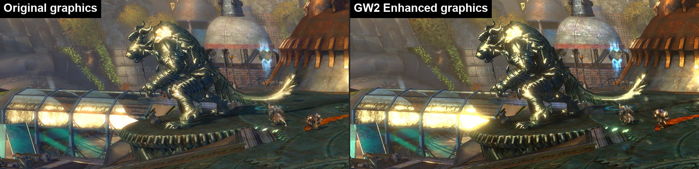
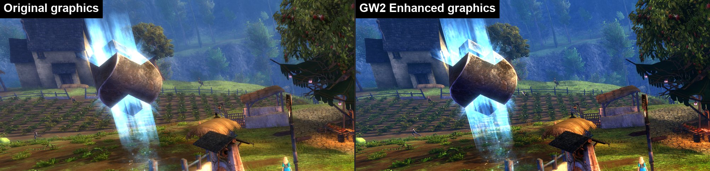
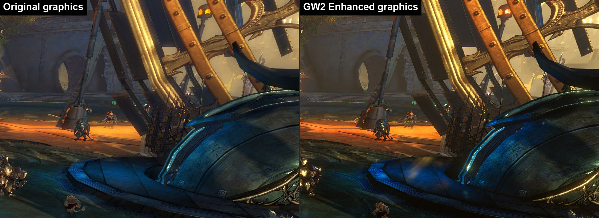
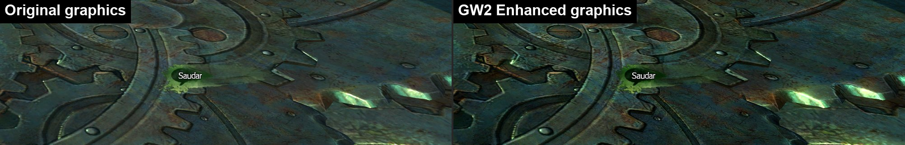
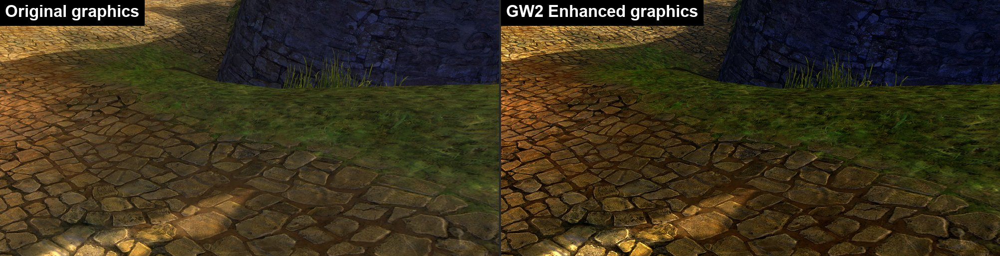
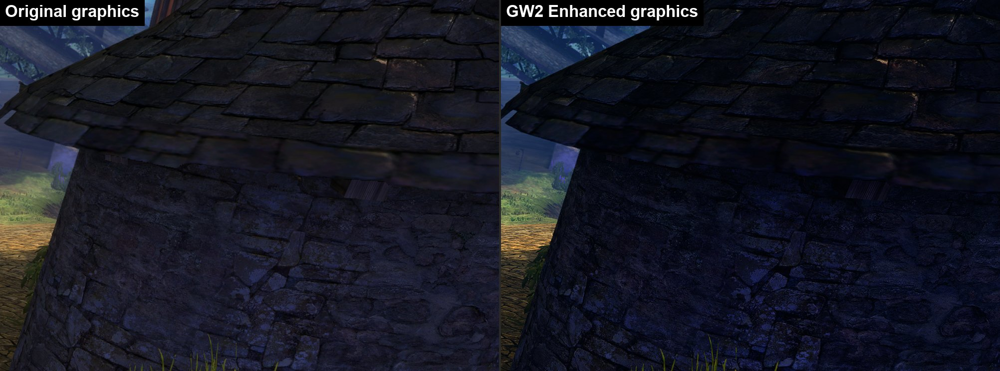

## Como as texturas HD foram feitas

O pacote HD é uma **remasterização das próprias texturas do jogo**, não arte nova. Nada foi desenhado, pintado, pedido
por prompt ou gerado do zero; cada textura HD é a textura original, ampliada.

**O estilo artístico do jogo é mantido.** O visual de pintura de Guild Wars 2, suas cores e seus detalhes pintados à mão
são da ArenaNet, e o pacote não os altera: sem recolorir, sem reestilização "realista", sem materiais novos, sem filtros.
O objetivo é que o jogo pareça exatamente ele mesmo, só que mais nítido de perto.

1. **Extração.** Cada textura é decodificada do `Gw2.dat` do jogador (cerca de 432 mil texturas; cerca de 231 mil delas acabam no pacote), com os pixels exatos e
   o formato de GPU que o jogo usa.
2. **Classificação.** Cada textura é identificada pelo que a usa (atlas de personagem, cabelo e olhos, armas e armaduras,
   cenário, criaturas, efeitos, terreno, interface) e recebe um tamanho-alvo a partir disso, não só pelo seu tamanho. Interface, arte
   de cinemáticas, texturas minúsculas e texturas que já são grandes o bastante ficam como estão.
3. **Ampliação.** As texturas de cor passam pelo **[4x-UltraSharp](https://huggingface.co/Kim2091/UltraSharp)**, um
   modelo de super-resolução de imagem única, executado localmente na GPU em blocos. Normal maps, máscaras e outras texturas de dados
   **não** passam por nenhum modelo: são redimensionadas com Lanczos, já que um modelo poderia inventar valores nelas.
4. **Codificação.** Cada resultado volta para o **mesmo formato de blocos** com que o jogo foi distribuído (BC1/BC3/BC5/BC7...), para que o motor
   o leia como se fosse a sua própria textura, e pares de texturas que o motor espera numa proporção exata de 2x a mantêm.
5. **Empacotamento.** Os resultados são guardados em alguns arquivos grandes com um índice, que o mod lê em tempo de execução quando o
   jogo pede uma textura (veja [`remastered/`](remastered/README.md) para os detalhes e as ferramentas).

**Isto é IA generativa?** Não, não no sentido habitual. O 4x-UltraSharp é uma rede de super-resolução com arquitetura ESRGAN
(um ampliador convolucional de imagem para imagem): sua única entrada é a textura original, ele não tem prompt nem modelo de texto,
e não cria conteúdo que já não esteja lá. Executado duas vezes na mesma textura, dá o mesmo resultado. Ele
**realça e reconstrói detalhes finos** (bordas, granulação, pequenos padrões) que um redimensionamento simples borraria, que é
aquilo para que foi treinado, com pares de fotos em baixa e alta resolução. As formas, cores, disposição e design de cada
textura continuam sendo da ArenaNet.

O 4x-UltraSharp é de Kim2091, sob [CC BY-NC-SA 4.0](https://creativecommons.org/licenses/by-nc-sa/4.0/): o pacote HD
é gratuito e não comercial.

## Downloads

Cada versão na [página de Releases](https://github.com/wilssola/GW2Enhanced/releases) traz:

| Arquivo | Conteúdo |
|---|---|
| `GW2Enhanced-All-<version>.zip` | os três recursos, tradução com todos os modos de tradutor |
| `GW2Enhanced-Translation-<version>.zip` | só a tradução, todos os modos de tradutor |
| `GW2Enhanced-Translation-CPU-<version>.zip` | só a tradução, tradutor no processador (o menor) |
| `GW2Enhanced-Translation-CUDA-<version>.zip` | só a tradução, tradutor em placas NVIDIA (CUDA) |
| `GW2Enhanced-Translation-DirectML-<version>.zip` | só a tradução, tradutor em qualquer placa DirectX 12 (AMD, Intel, NVIDIA) |
| `GW2Enhanced-Textures-<version>.zip` | só o runtime das texturas HD (o pacote em si é um download separado, veja abaixo) |
| `GW2Enhanced-Graphics-<version>.zip` | só os gráficos |
| `SHA256SUMS.txt` | o SHA-256 de cada arquivo acima |

Cada versão também tem um atestado de proveniência de build: o GitHub assina qual commit e qual execução de workflow produziu cada
arquivo, então qualquer pessoa pode verificar um download com `gh attestation verify <file> --repo wilssola/GW2Enhanced`.

O **pacote de texturas HD** (cerca de 95 GB) é publicado no [Nexus Mods](https://www.nexusmods.com/guildwars2/mods/10), dividido em um pacote principal obrigatório e dois pacotes 4x
opcionais. Extraia todas as partes na pasta do jogo; o mod procura `GW2Remastered\pack` ali (ou na pasta que você escolher
no painel dele).

## Instalação

1. Feche o jogo.
2. Extraia o zip na pasta do jogo (a que tem o `Gw2-64.exe`), ou execute o instalador que ele contém, que encontra a
   pasta sozinho. Se outro mod já tiver um `msimg32.dll` ali, o instalador avisa e só o substitui se você escolher
   (ele fica guardado e volta ao desinstalar). O `version.dll` do antigo
   GW2 Translated separado é removido (a tradução agora fica no `msimg32.dll`).
3. Inicie o jogo. **Shift+Home** abre o overlay, com uma aba por recurso e uma aba **Health** que lista cada parte do
   mod e se ela está funcionando. As teclas de atalho ficam na aba **Version** (e em `GW2Enhanced\config.ini`): uma para a janela e uma por recurso, todas
   **Shift+Home** por padrão; a tecla de um recurso abre a janela direto na aba dele.

O instalador (`GW2Enhanced-Installer.exe`) também é um pequeno launcher: ele encontra o jogo na Steam, na Epic Games e no
cliente da ArenaNet, lista as versões com suas notas, baixa e instala um pacote com a mesma verificação de
assinatura do atualizador do jogo, e inicia o jogo pela loja certa.

| | |
|---|---|
| 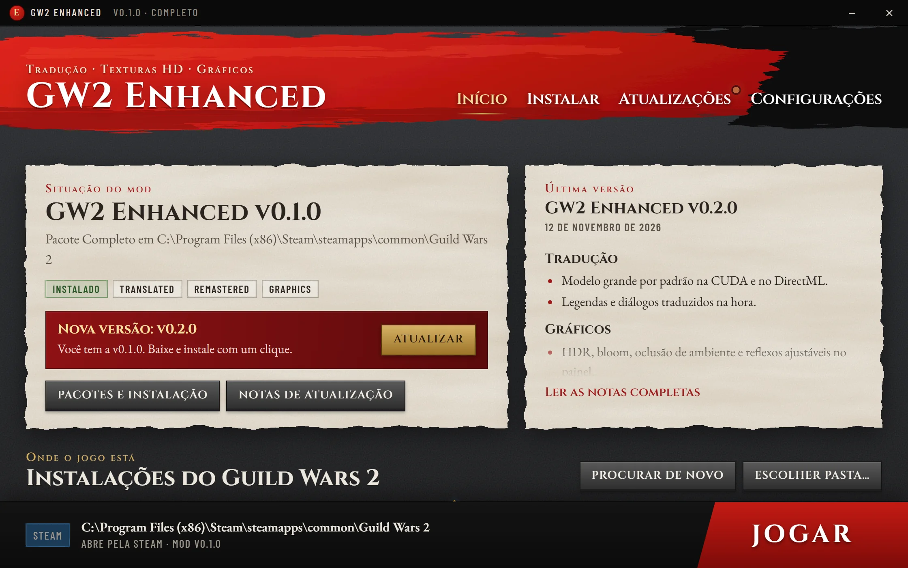 | 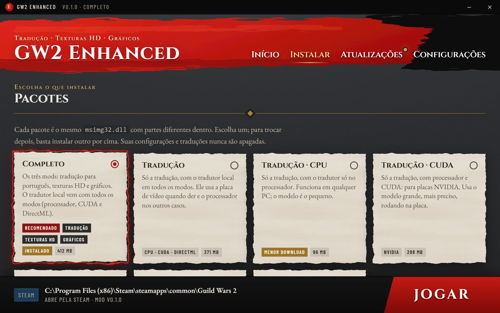 |
| 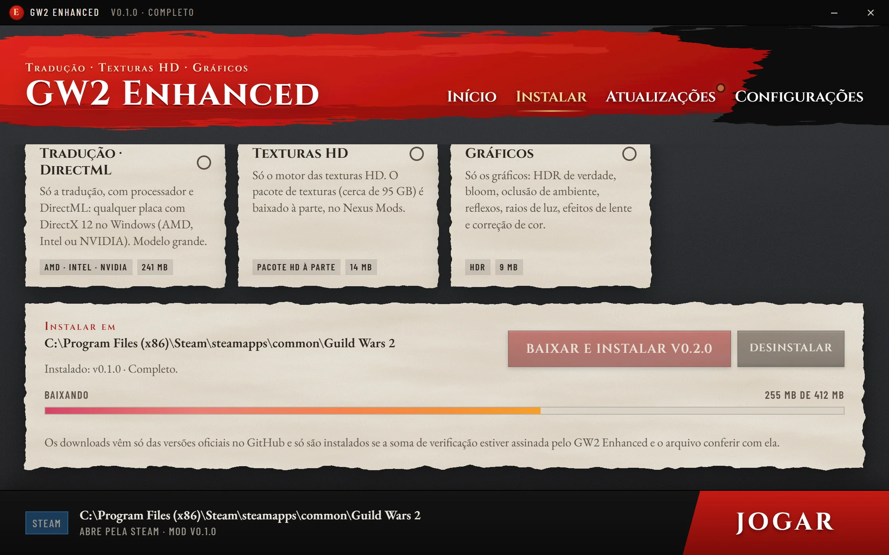 | 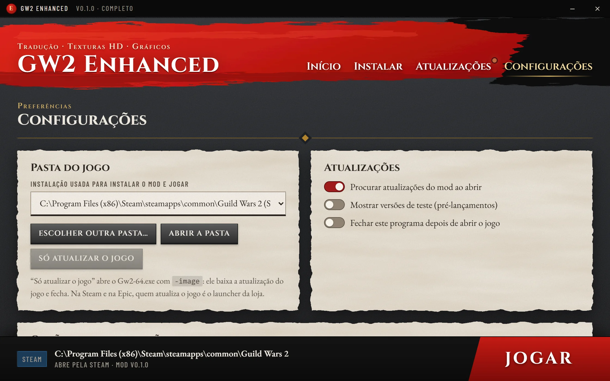 |

<sub>O instalador, com dados de exemplo.</sub>

No Linux, use o `GW2Enhanced-Installer-linux-amd64.AppImage` (ou o `.deb`) da versão. O Wine e o
Proton carregam o próprio `msimg32.dll` a menos que se diga o contrário, então o jogo precisa da opção de inicialização
`WINEDLLOVERRIDES="msimg32=n,b" %command%` na Steam; o instalador pode adicioná-la para você (com a Steam fechada). Veja
[installer/docs/launch-methods.md](installer/docs/launch-methods.md).

Para desinstalar, apague o `msimg32.dll` da pasta do jogo (ou execute o instalador com `--uninstall`). Um
`wtsapi32.dll` antigo, da versão anterior independente dos gráficos, não é removido pelo instalador: apague-o à mão.

## Configurações e logs

O `GW2Enhanced\config.ini` na pasta do jogo guarda as configurações compartilhadas por todo o mod; o overlay o escreve para você:

| Chave | Padrão | Significado |
|---|---|---|
| `ui_language` | Idioma do Windows | Idioma do overlay: `en` ou `pt-BR` (o seletor acima das abas). Um Windows em português começa em `pt-BR`, qualquer outro em inglês. Este não é o idioma para o qual o jogo é traduzido: esse é o "Idioma da tradução do jogo" da aba Translation. |
| `log_host` | `0` | Log do overlay e do atualizador: `GW2Enhanced\gw2enhanced_log.txt` |
| `log_translation` | `0` | Log da tradução: `GW2Translated\gw2translated_log.txt` |
| `log_textures` | `0` | Log das texturas HD: `GW2Remastered\gw2remastered_log.txt` |
| `log_graphics` | `0` | Log dos gráficos: `GW2Graphics\gw2graphics_log.txt` |
| `graphics_setup_done` | `false` | A parte dos gráficos da configuração inicial foi concluída ou pulada (`false` mostra de novo) |
| `check_updates` | `true` | Procurar uma nova versão ao iniciar |

Os logs ficam **desligados por padrão**: nenhum arquivo de log é escrito. Ao relatar um problema, primeiro ligue os **Logs** da parte que
está com problema na aba Health do overlay (vale na hora), reproduza o problema e então anexe esse arquivo (e
o `.prev.txt` dele, da sessão anterior). Com os logs desligados, a aba Health ainda mostra o estado de cada parte e os problemas
recentes que ela notou.

## Atualizações

A cada inicialização, o mod verifica a versão mais recente. Quando há uma mais nova, ele pergunta no overlay; se você aceitar, ele
baixa o mesmo pacote que você instalou (mesmos recursos, mesmo modo de tradutor), confere-o com o `SHA256SUMS.txt` da versão
e com a assinatura ed25519 desse arquivo, substitui seus arquivos e fecha o jogo para que a próxima inicialização rode a nova versão. Nada é substituído
se um download estiver incompleto, não bater com o checksum ou se os checksums não estiverem assinados pela chave do projeto.

Suas configurações (`config.ini`) e suas próprias traduções nunca são tocadas. Para desligar a verificação, coloque
`check_updates=false` em `GW2Enhanced\config.ini` na pasta do jogo. A aba Health mostra o estado da atualização, e o
`GW2Enhanced\gw2enhanced_log.txt` o que o atualizador fez (com `log_host=1`, veja [Configurações e logs](#configurações-e-logs)).

## Como funciona

- **Uma DLL proxy.** O `Gw2-64.exe` importa o `msimg32.dll`, uma pequena biblioteca do Windows (5 funções) que não está na
  lista KnownDLLs, então o Windows carrega primeiro a cópia que está na pasta do jogo. A nossa repassa essas 5 funções para a verdadeira em
  System32 e inicia os recursos em suas próprias threads, nunca sob o loader lock.
- **Isolamento.** Cada recurso inicia dentro da sua própria proteção: se um falhar (por exemplo, depois de um patch do jogo), ele se desliga,
  diz o porquê na aba Health e no log, e os outros continuam rodando.
- **Translation** intercepta as funções em que o jogo transforma um id de string em texto, e troca pelo texto traduzido
  de um dicionário (por id, então funciona com qualquer idioma do cliente). As strings que faltam vão para uma fila de um tradutor local
  (CTranslate2 com um modelo OPUS-MT) que roda como um processo separado.
- **HD textures** intercepta a camada de arquivos do jogo no ponto em que ela lê uma textura do `Gw2.dat`, e devolve a versão HD
  do pacote no lugar (guardada no mesmo formato de blocos de GPU que o jogo espera, então nada é convertido em tempo de
  execução). O pacote é um punhado de arquivos grandes com um índice, lidos por offset.
- **Graphics** intercepta o Direct3D 11 e reconhece as passadas de renderização do jogo pela estrutura delas (formatos, tamanhos, ordem,
  quantidade de draws), e os poucos shaders do motor que substitui pelo hash do bytecode deles. Ele converte os render
  targets da cena para ponto flutuante, adiciona seus efeitos entre as passadas do jogo e converte o resultado para HDR no final.
- O código do jogo é encontrado por assinaturas de bytes com curingas sobre as realocações, que sobreviveram sem mudanças aos patches até agora;
  veja [a arquitetura do mod](docs/specs/unified-mod-design.md) para saber como o mod localiza o código do jogo, se degrada
  quando um patch quebra algo, e se atualiza.

## A tradução

- **Um dicionário vem com o mod** (`GW2Translated\languages\pt-BR\dictionary.jsonl`, cerca de 205 mil strings).
  Os textos são procurados pelo seu texto em inglês e pelo ID de texto do jogo, então a tradução também funciona com o jogo em
  outro idioma; uma tradução pode ter qualquer tamanho.
- **O que falta no dicionário é traduzido no seu PC**, offline: um tradutor local (CTranslate2 com um modelo OPUS-MT)
  roda como um processo separado em baixa prioridade, no processador (modelo pequeno) ou na placa de vídeo (um modelo
  maior, em NVIDIA via CUDA ou em qualquer placa DirectX 12 via DirectML). Ele precisa do cliente em inglês. Os diálogos do mapa
  são traduzidos com antecedência, e o resultado aparece assim que fica pronto. As páginas do Trading Post, da Gem Store e do Wizard's
  Vault são traduzidas do mesmo jeito.
- **O site da comunidade** ([gw2enhanced.wilssola.dev](https://gw2enhanced.wilssola.dev)) mostra cada texto com
  sua tradução e as alternativas. Qualquer pessoa pode votar a favor ou contra uma tradução ou sugerir uma melhor, sem
  conta (uma verificação do Cloudflare Turnstile, um voto por IP por tradução). A tradução revisada mais bem votada passa a ser
  a atual.
- **Enviar textos é opcional.** No primeiro uso, o overlay pergunta se você quer ajudar (`contribute=ask` até você
  responder). Se você concordar, o mod envia os textos do jogo em inglês que encontrou e que ainda não têm tradução, o ID de texto e o
  inglês das strings protegidas que ele descriptografou, e as traduções feitas no seu PC. Ele nunca lê, salva nem envia o
  chat dos jogadores, e nunca envia dados pessoais nem os textos de páginas web traduzidos no seu PC (`web_local.jsonl`). Isso pode
  ser desligado a qualquer momento no overlay ("Ajudar a melhorar a tradução") ou com `contribute=false` em
  `GW2Translated\config.ini`.
- **O servidor não confia em nada do que recebe** ([API](backend/docs/api.md)). Tudo vai primeiro para uma fila de revisão:
  os textos em inglês são comparados com o que outros jogadores enviaram para o mesmo ID ou revisados como texto plausível do jogo, e as
  traduções são revisadas automaticamente (elas precisam traduzir o inglês, manter a marcação do jogo e não ser uma
  piada, um insulto, spam ou um link). Um texto guarda no máximo 10 traduções diferentes, e uma tradução enviada para um texto
  que já tem uma tradução feita pelo próprio modelo do servidor não é armazenada. Endereços IP nunca são armazenados: só
  hashes HMAC-SHA256 com salt do endereço e da sua faixa de rede, para limites de taxa e banimentos.

## Os gráficos, comparados com outros mods de gráficos

O recurso Graphics funciona **dentro do próprio renderizador do jogo**. Ele intercepta as chamadas Direct3D 11 do motor, reconhece
as passadas dele e trabalha entre elas: vê a cena e o próprio depth buffer do motor **antes de a interface ser desenhada**,
então seus efeitos nunca tocam a interface e usam a profundidade real da cena. Ele torna possível o **HDR de verdade** criando os
render targets da cena em ponto flutuante de 16 bits em vez de 8 bits, para que fogo, magias e o sol possam ser mais claros que o
branco até chegar a um monitor HDR. Ele **não precisa de rede neural** nem de API específica de fabricante: apenas shaders Direct3D 11
comuns, em qualquer placa de vídeo em que o jogo rode. Cada efeito tem seu próprio interruptor, e ele foi projetado para rodar junto com o
ReShade.

| | GW2 Enhanced Graphics | [ReShade](https://reshade.me) (presets como os de [Elora](https://alteredm1nd.github.io/gw2-reshade-eloras-personal-presets)) | [RenoDX](https://github.com/clshortfuse/renodx) | [GW2Hook](https://04348.github.io/Gw2Hook) | [d912pxy](https://github.com/megai2/d912pxy) | [NVIDIA DLSS 5](https://www.nvidia.com/en-us/geforce/news/dlss-5-3d-guided-neural-rendering/) |
|---|---|---|---|---|---|---|
| O que é | Efeitos e HDR dentro das passadas de renderização do jogo | Shaders de pós-processamento sobre o quadro do jogo | Add-on do ReShade que substitui os shaders de um jogo, principalmente para HDR | Fork do ReShade feito para o GW2 | Wrapper de DirectX 9 para DirectX 12 | Etapa de renderização por IA no final do pipeline de um jogo |
| Onde atua | Entre as passadas do motor, antes da interface | No quadro apresentado (interface incluída, a menos que um add-on encontre um ponto anterior) | Substituição de shaders por jogo | Patch no shader de neblina, efeitos antes do HUD | Traduz toda a API DX9 | Dentro dos jogos que o integram |
| HDR | Targets da cena em ponto flutuante, saída scRGB ou HDR10 | Depende do jogo e dos add-ons | Seu objetivo principal | Não | Não | Não é o objetivo dele |
| GPU | Qualquer placa que rode o jogo | Qualquer | Qualquer | Qualquer | Qualquer (DX12) | GeForce RTX série 50 |
| Situação no GW2 | Atual | Funciona com o cliente DX11 (como `d3d11.dll`/`dxgi.dll`) | Mod do GW2 listado como em andamento | Feito para o antigo cliente DirectX 9 | Obsoleto: o GW2 abandonou o DirectX 9 | O GW2 não o integra |

Notas sobre a tabela:
- O ReShade é o jeito habitual de mudar o visual do GW2: presets de cor, nitidez, oclusão de ambiente e profundidade de campo a partir
  da profundidade. Seus efeitos rodam sobre a imagem que o jogo apresenta; o recurso Graphics muda como o quadro é renderizado. Os dois
  podem ser usados juntos: com o ReShade carregado, `hdr_output=auto` fica em SDR porque os efeitos do ReShade na swapchain
  não são seguros para HDR ([detalhes](graphics/README.md#hdr-output-and-reshade)).
- A lista de mods do RenoDX tem uma entrada de Guild Wars 2 marcada como "in progress, lacking testing" (em andamento, sem testes)
  ([lista de mods do RenoDX](https://github.com/clshortfuse/renodx/wiki/mods)).
- O GW2Hook era voltado ao cliente DirectX 9 (remoção de neblina por patch nos pixel shaders, efeitos aplicados antes dos nomes e do
  HUD). O d912pxy foi arquivado em maio de 2025, depois do cliente DirectX 11: a ArenaNet passou todos os jogadores para o DirectX 11 e removeu o
  renderizador DirectX 9 ([ArenaNet, requisitos de sistema](https://guildwars2.com/en/news/guild-wars-2-minimum-system-requirements-update)).
- O DLSS 5 (anunciado em março de 2026) é um modelo de IA que adiciona detalhes de iluminação e de material no final do pipeline,
  a partir da cor e dos vetores de movimento de um quadro, mais dados do motor; os desenvolvedores do jogo precisam integrá-lo, e ele exige uma
  placa GeForce RTX série 50. O GW2 não tem upscaling DLSS ou FSR nativo. O GW2 Enhanced não faz upscaling e não usa
  IA em tempo de execução.
- Desempenho: as passadas extras são pequenas (a maioria dos efeitos é estimada bem abaixo de um milissegundo em 3440x1440 numa
  GPU intermediária; o profiling dentro do jogo ainda está por fazer), e um efeito desligado (intensidade 0) não adiciona nenhuma passada.
  Os números por efeito estão em [graphics/docs](graphics/docs/specs/graphics-design.md).

## Compilação

Um único workspace Cargo; Windows, Rust stable, MSVC.

```sh
cargo build --release              # target/release/msimg32.dll with the three features (+ the installer)
cargo mod-translation              # msimg32.dll with only the translation
cargo mod-textures                 # ... only the HD textures
cargo mod-graphics                 # ... only the graphics
cargo test --workspace             # the graphics tests take about 30 min (shaders on WARP)
```

Todo projeto gera o mesmo `msimg32.dll`; as features do cargo de [`enhanced/`](enhanced) (`translation`, `textures`,
`graphics`) escolhem o que entra. O tradutor local (`-p gw2translated-translator`) precisa dos runtimes do CTranslate2 e do
DirectML, baixados pelos scripts em `translated/scripts`. O modelo de tradução é guardado com Git LFS.

`.\scripts\package.ps1 [-Version 1.2.0] [-Package Graphics,...]` gera os zips de versão da tabela acima em
`dist\`. Ele não precisa de Git LFS nem de nada instalado à mão além do Rust, do Visual Studio com C++ e, para os
pacotes CUDA e DirectML, do [uv](https://docs.astral.sh/uv/): os runtimes, o cuBLAS e o modelo pequeno são
baixados (com versão fixa e SHA-256 verificado) e o modelo grande é convertido a partir do Hugging Face. A CI
([`ci.yml`](.github/workflows/ci.yml)) compila e testa cada push e pull request; enviar uma tag `v<version>`
(ou executar o [`release.yml`](.github/workflows/release.yml) à mão) publica uma versão.

| Pasta | O quê |
|---|---|
| `enhanced/` | a DLL: ponto de entrada, proxy, o overlay compartilhado e a aba Health |
| `core/` | infraestrutura compartilhada: busca de assinaturas entre builds, o registro de saúde |
| `translated/`, `remastered/`, `graphics/` | os três recursos (bibliotecas compiladas dentro do `msimg32.dll`), suas ferramentas e documentação |
| `installer/` | o instalador e launcher (Tauri; Windows e Linux) |
| `backend/` | Cloudflare Worker para as contribuições de tradução e as versões (projeto separado) |

## Como contribuir

Ajuda é bem-vinda, e o **recurso Graphics precisa especialmente de testadores**: jogadores que possam testá-lo em GPUs,
monitores (SDR e HDR) e mapas diferentes, comparar os efeitos ligados e desligados, e relatar o que parece errado ou quais configurações ficam melhores.
Veja o [CONTRIBUTING.md](CONTRIBUTING.md) e abra uma issue do tipo *Graphics calibration report*.

- [Guia de contribuição](CONTRIBUTING.md) · [Código de Conduta](CODE_OF_CONDUCT.md) · [Como obter ajuda](SUPPORT.md) ·
  [Política de segurança](SECURITY.md)
- As traduções são melhoradas votando e sugerindo no [site](https://gw2enhanced.wilssola.dev).

## Créditos

- Pelo em camadas (Graphics): o visual e a técnica de camadas seguem o [UnityFurURP](https://github.com/hecomi/UnityFurURP)
  de hecomi; os shaders aqui são uma reescrita para o renderizador Direct3D 11 do jogo.

## Aviso

O GW2 Enhanced é um **projeto de fã não oficial**. Ele não é feito, endossado, apoiado nem afiliado à ArenaNet, LLC ou à
NCSOFT Corporation. É um mod do lado do cliente: muda apenas o que o seu próprio computador mostra, não envia nada aos
servidores do jogo e não dá nenhuma vantagem de jogabilidade. Programas de terceiros que interceptam o cliente do jogo são usados **por sua conta e risco**;
leia a [política sobre programas de terceiros](https://help.guildwars2.com/hc/en-us/articles/360013658134) da ArenaNet e o
Contrato de Usuário do jogo antes de usá-lo. Os autores não são responsáveis por qualquer ação tomada em sua conta.

As texturas HD são derivadas das próprias texturas do jogo e são distribuídas apenas como um mod para quem possui o jogo.
Nenhum arquivo do jogo está incluído neste repositório.

## Direitos autorais

© ArenaNet, LLC. Todos os direitos reservados. NCSOFT, o logotipo NC entrelaçado, ArenaNet, Guild Wars, Guild Wars 2, Heart of
Thorns, Guild Wars 2: Path of Fire, Guild Wars 2: End of Dragons, Guild Wars 2: Secrets of the Obscure, Guild Wars 2:
Janthir Wilds, Guild Wars 2: Visions of Eternity e todos os logotipos, designs e marcas compostas associados são marcas comerciais
ou marcas registradas da NCSOFT Corporation. Todas as outras marcas comerciais pertencem aos seus respectivos donos.

O código do GW2 Enhanced está sob a [licença MIT](LICENSE), exceto os componentes de terceiros, que mantêm suas próprias
licenças (listadas no README de cada mod).
